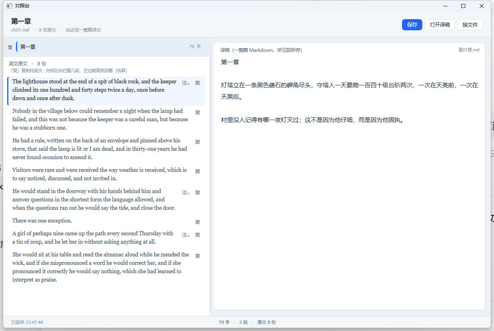

# YiTai · 译台

一个给"边读原文、边写译文"的人用的 Windows 小工具：左边整篇原文，右边整篇译文，停手就存。



## 它是什么

- **翻译按项目管理**。一个项目 = 一个普通文件夹，里面有原文、译文、备份和一份项目清单。
- **右边整篇译文**（所见即所存），**左边可以并排好几栏对照**：资料、原文、另一种语言的译文都摊在同一屏。
- **译文永远在最右**。对照栏只读，可以增减、可以左右调顺序，每栏自己选放哪份文件。
- **原文不切句、不认注、不分章节**。导入进来是什么样就怎么画，只是把 Markdown 的
  加粗、斜体、标题、列表、代码块、引用、链接画成"真的样子"，不再显示一堆星号。
  （只有 `.md` / `.markdown` 这么画；`.txt` 按纯文本一行一段显示，
  免得正文里的 `*`、`#` 被当成格式吃掉。PDF 不走这条路，见下面"PDF 按原件显示"。）
- **每栏可以各自缩放**（70%~250%，`− % +` 或鼠标停在这栏上按 Ctrl+滚轮）。放大是
  "字变大、行重新折"，按当前栏宽重排，不会把文字挤出栏外。
- 译文栏脚下**实时显示字数 · 段数 · 选中几个字**；右上角「预览」能把译文按 Markdown
  画一遍看效果（预览只读，再点一下回编辑）。
- 译文停手 1.2 秒自动保存，Ctrl+S 随时保存，切文件/关窗口前强制保存。
- 磁盘被别的程序改过会拦下来问一句，绝不悄悄覆盖。

## 它不是什么

- 不是"一句原文配一个译文框"的卡片工具（那会把文章切碎，读不出上下文）。
- 不是排版工具，不是 CAT（翻译记忆库）。Markdown 只画常用的那几种：标题、段落、粗斜体、
  行内代码、代码块、引用、有序/无序列表、删除线、链接、`==高亮==`（红色荧光底）。
  表格、脚注、内嵌 HTML 不认，会原样当文字显示 —— 宁可难看，也不假装支持。
  这套语法是 CommonMark 加两个事实标准（GFM）：`~~删除~~` 和 `==高亮==`，
  在 Obsidian / Typora / GitHub 上都能正常显示。
- **不做 OCR**：PDF 要有文字层才读得出字；扫描件、拍照件读不出，软件会直说，不会硬猜。
- 不预设"每章一个文件"，也不预设"源文件里有什么注解"。

## 项目就是一个文件夹

新建项目时选一个空文件夹，软件在里面建这些：

```
<项目根>\
  project.json      项目清单：有哪些译文、各有几栏资料、上次打开的是哪一篇
  translations\     ★ 所有译文都只落在这里，一篇一个文件
  sources\          想归档的原稿/资料（可选，不归档也能翻译）
  backups\          每天第一次保存前的上一版
  .yitai\           程序自用：progress.json（每栏"译到哪个字"的进度线位置）
```

**为什么是文件夹而不是一个"项目文件"**：译文必须是能单独打开的 `.md`，
能被你自己的编辑器、git、排版流程直接用。都塞进一个二进制/JSON 里，谁也读不了。

**软件只有两类东西，而且不许猜**：

| | 在哪 | 能不能改 | 怎么进来 |
|---|---|---|---|
| **译文** | `translations\` | 能写 | 「＋ 新建译文」或「把已有文件收进来当译文」 |
| **资料**（参考） | 你随便放哪 | 只读 | 「打开文件」/ 栏顶下拉的「打开文件…」 |

没有"原文"这个概念。一份 `.md` 是"译文"还是"资料"，不取决于它叫什么、放在哪、
跟谁同名 —— 只取决于你是点了"新建译文/收进来"，还是"打开文件"。
所以同一份文件可以既当资料看、又另存一份当译文写；把这个软件用来干别的也完全成立。

**为什么原稿要复制进来**：一个文件夹就是一次完整的翻译工程，
压缩、搬走、换机器、发给朋友都不会断链。原始路径记在清单里，只作记录。

## 用起来

1. `文件 → 新建项目…`，选一个文件夹
2. `文件 → 新建译文…`（或右上「＋ 新建译文」）：起个名字就开写，**不需要先有原文**。
   空的译文统一建在 `translations\` 里，一篇一个 `.md`
3. 已有稿子想收进来：`文件 → 把已有文件收进来当译文…`，选一个 md/txt，
   复制进 `translations\`（同名就加 (2)，绝不覆盖你改过的那版）
4. 要参考什么东西：`文件 → 打开文件看（只读）…`，或栏顶下拉的「打开文件…」——
   **任何格式都收**（.md/.txt/.pdf/图片/别的），只读、不复制、不进清单。
   已经有空栏就先填进空栏，不会白白多长出一栏
5. 译文栏顶部下拉**只列译文**；栏底实时显示「字数 · 段数 · 选中字数」，
   右上「预览」把译文按 Markdown 画一遍（只读，再点一下回编辑）
6. `◀ ▶` 调左右顺序，`✕` 关掉。**译文栏不参与挪位，永远钉在最右**；栏位按项目分别记住。
   栏底 `− 100% +` 调这一栏的显示比例（Ctrl+滚轮也行）：Markdown 栏是字变大、按栏宽重新折行；
   PDF 栏是缩页，不重排版
7. `Ctrl+S` 保存，或者什么都不用做（停手就存）
8. 「译到哪了」——资料栏上有一根绿色竖线（像一根粗一点、两端带圆弧、微微发光的光标），把译完的和没译的隔开：

   - **在原文栏里点一下**（不拖选）→ 竖线就立在那句话前面，栏底写「译到 4398/5174 字（85%）」
   - `Ctrl+Shift+↑ / ↓` → 上一句 / 下一句（按标点切句，不按段落跳；手在译文栏打字时不用摸鼠标）
   - 右键 → 「把进度标记放在这里」/「清除进度标记」（兜底）
   - 拖选复制时不会误标（松手时选着字就不动），点在栏的空白处也不动，点错了点回原处就行
   - **双击选词也不会误标**：单击要等过一个双击间隔才落线，第二下（双击）一到就把排队的那条撤掉
   - 栏里放的是 **PDF** 时这一栏不出进度线：原件是 Edge 内核画的，拿不到"点在哪个字上"。
     要看 PDF 又要进度线，就另开一栏指着同一份 `.md`/`.txt`

   线绑的是**原文里的字符位置**，不是"第几段"——原文常常一整章就是一大段，按段落标等于没标。
   所以原文增删几句、缩放 200%、切章回来、重开软件，线都还在原来那句上。

   **它不参与排版**：竖线是浮在正文之上的一层画板（3px 宽、两端圆角、带一点绿光），
   不插字、不切段、不改行距。画上它和没画它，正文的折行、段间距、滚动条长度一模一样。
   位置记在 `.yitai\progress.json` 里，不进 `project.json`。
7. 已有旧译文？`文件 → 关联已有译文…`，选放旧稿的文件夹，按**章号**配对
   （`ch02.md` ↔ `第02章.md`）。同一章号有多个候选（例如 `第02章-二校建议.md`）时，
   优先认名字干净的那个；分不出来就**跳过**，不替你猜。

菜单里还有 `保存`、`另存为…`（改这份译文的落盘位置，记进项目清单）、`退出`。

## 四条落盘规矩

| 规矩 | 为什么 |
|---|---|
| 换行、BOM 照原文件 | 你的稿子有 CRLF 有 LF，统一成一种会让 git 认为每行都改过 |
| 原子替换（先写 .tmp 再 move） | 写一半断电不会留半个稿子 |
| 每天首次保存前备份到 `backups\` | 一天攒几十个备份没意义，但一天一份很有用 |
| 空稿拒绝落盘 | 一次误全选删除不会把整章清空 |

## 想加功能的时候（给未来的自己 / 贡献者）

代码边界是刻意划开的：

- `YiTai.Core` 不知道界面存在。它只有项目、文件、文本、落盘。
- `YiTai.App` 不知道"章节""注解""切句"这些词。它只拿"一份原文全文 + 一份译文全文"。
- 所有路径都在 `ProjectLayout` 里拼，别在别处拼路径。

所以像下面这些功能，都是**加一层，不动现有界面**：

- 章节树 / 目录大纲 → 读原文算出一份结构，挂在左栏侧边
- 双语逐句对照 → 新的"阅读器"面板，用同一份原文与译文算对齐
- 术语提示、翻译记忆 → 右侧编辑区旁边加一个侧栏
- 原文格式识别（脚注、卡片注） → 放在"阅读器"里，不影响落盘

项目数据里**不存**这些派生物：它们是视图，随时可以重算，不该污染 `project.json`。

## 构建

需要 .NET SDK 10（桌面开发工作负载）。

```
git clone https://github.com/<you>/YiTai.git
cd YiTai
.\build.ps1              # 调试版 → src\YiTai.App\bin\Debug\net10.0-windows\YiTai.exe
.\build.ps1 -Release     # 单文件免安装 → dist\YiTai.exe（约 60MB，自包含运行时）
dotnet run --project tests\YiTai.Tests   # 冒烟测试，退出码 0 = 全过
```

设置文件在 `%APPDATA%\YiTai\settings.json`（上次的项目、窗口尺寸、自动保存间隔）。
栏位摆法与每栏放的文件、显示比例跟着项目走，记在项目内的 `.yitai\panes.json`。

## 已知边界

- 只支持 Windows（WPF）。
- 对照栏只读、可选中复制；不做逐句高亮、不做"切句成一排小框"的那套。
  「译到哪了」只是一条线 + 一个字符偏移，不参与编辑，也不改任何文字的排布。
- 对照栏最多 4 个。栏位、每栏放的文件、栏宽、每栏的显示比例按项目记在
  `.yitai\panes.json`（跟进度文件放一起，整个项目文件夹搬走也还在），同时也写一份到
  `%APPDATA%\YiTai\settings.json` 作兼容。都不写进 `project.json`：那是"这本书怎么翻"，
  不是"这个软件上次什么样"。
  打开项目时按这份记忆把栏摆回来，并把有进度的栏滚到上次停下的那条线那儿。
  项目里一次都没记过栏位时，会按进度记过的文件自动摆（最多两栏），不是甩一排空栏。
- 对照栏是"渲染视图"，Markdown 只画常用语法；要改里面一个字，去源文件改。
- 不监控外部改动之外的文件系统事件；别的程序在你正写着时改了同一份稿，靠保存时的 sha 比对发现。
- 大文件（几十万字）整篇装进编辑区/渲染文档会很吃内存，适合按章/按篇分文件。
  单栏缩放到 250% 时排版成本更高，几万字以内无感。
- 进度线**按栏各记各的**：原文栏记原文那份的进度，对照栏里的另一份 `.md`/`.txt` 记它自己的，互不覆盖。
  PDF 栏是原件渲染，不记进度。
  它**不会**自己跟着译文光标往前跑：两份文本之间没有对齐数据，按段落序号硬推，
  一段对不上就整条线静默错位 —— 宁可让人点一下。
- 点正文落线的判据目前是"**排除法**"：抬起鼠标时，如果这一下按在滚动条（滑块、箭头、轨道）上，就直接忽略。
  必须挡这一下，是因为 WPF 的滚动条是 RichTextBox 模板里的**子控件**——你在滚动条上松开，
  鼠标事件照样会经过正文控件；早先没挡，于是"拖一下滚动条"被当成"点了一下正文"，线跳到别处。
  之所以不用"正文安全区"（只认正文视口矩形内的点）：排除法的边界不会算错，也不会把正文右侧那一列
  误切成"点不动"。**但这是黑名单，代价记在这里**：
  - 以后对照栏里若添了侧栏、行号、批注列、悬浮按钮这类可点的附件，每加一个都得在
    `MainWindow.Marker.cs` 的 `IsFromScrollBar` 旁边补一条排除；漏一条，就是"点它一下，进度线跳走"。
  - 一旦再收到"点在某某处、线跳到别处"的反馈，或需要让不同区域承担不同的点击含义，
    就该换成安全区方案：以正文 `ScrollViewer` 的实际矩形（扣掉它自己的垂直滚动条实际宽度）
    为主判据，黑名单只作兜底。这块矩形不用手算像素——是控件自己报的数，缩放和 DPI 都算在里面。
- 对照栏能放 `.md` / `.txt` / `.pdf`。**PDF 按原件显示**：交给系统里的 WebView2（Edge 内核）
  直接画出来，彩图、字体、分栏、页码、页眉页脚原样都在，还可以用它的工具栏缩放、翻页、搜索。
  代价是这一栏**不能点进度线**（原件里没有"第几个字"这种信息），也**不参与**"字数/段数"统计。
  WebView2 Runtime 是 Win10/11 装 Edge 时一起装的，正常机器上不用另装；万一没有，
  这栏会显示一片空白，装一下 `Microsoft Edge WebView2 Runtime` 即可。
  加密或损坏的 PDF 会显示阅读器自己的提示页，软件不会假装空白。
- **不做 OCR**：PDF 直接原件显示，不需要软件去识字；扫描件、拍照件同理——你看到的就是原图。

## 许可与样例

MIT，见 `LICENSE`。

`samples\demo\` 是一个可以双击打开的小项目（原文是自造的"守塔人"短文，无版权问题）。
仓库里不放任何仍在版权保护期内的译本正文。
